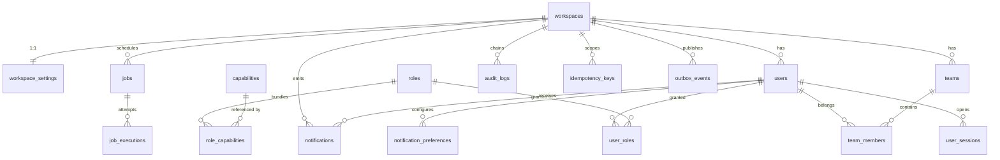
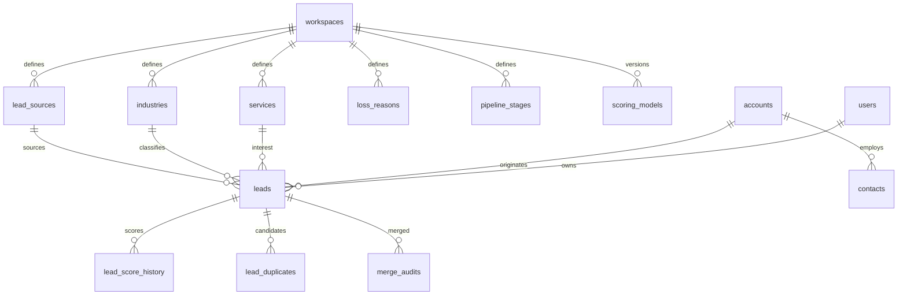
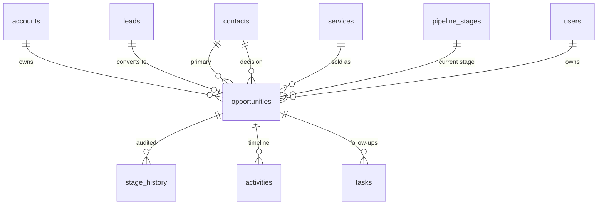
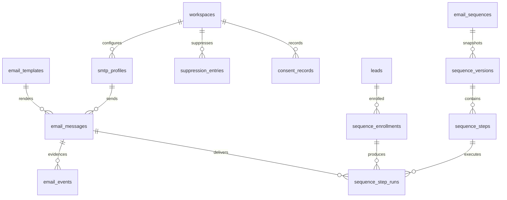

# Entity-relationship model

Mermaid sources are rendered by GitHub/GitLab; the table list mirrors
`docs/database/data-dictionary.md` (generated from the migrations).

## 1. Identity, tenancy and governance



Key invariants:

* `users (workspace_id, email_normalized)` is unique — one identity per workspace.
* `roles.code` is globally unique; system roles have `workspace_id = NULL` and are immutable
  templates that a workspace can clone.
* `audit_logs` is append-only; `record_hash` forms a per-workspace hash chain over
  `prev_hash | record id | workspace | actor | action | object | outcome | before | after | correlation`.
* `outbox_events (workspace_id, dedupe_key)` and `idempotency_keys (workspace_id, scope, key_value)`
  make retries safe.

## 2. Demand: catalogues, leads, duplicates, scoring



Key invariants:

* `leads.score` is `0..100` (CHECK) and every change writes `lead_score_history` with the factor
  breakdown and the scoring-model version that produced it.
* `lead_duplicates (lead_id, candidate_type, candidate_id, match_type)` is unique; resolution is
  `PENDING | MERGED | IGNORED | NOT_DUPLICATE` — detection never merges by itself.
* `merge_audits` stores the field decisions, so a merge is reproducible and reversible in review.

## 3. Revenue: opportunities and stage history



Key invariants:

* `opportunities.amount >= 0`, `probability BETWEEN 0 AND 100` (CHECK).
* Weighted value is always derived (`amount × probability ÷ 100`) — never stored, so it cannot drift.
* `stage_history` records `from`, `to`, actor, reason and `rule_version` (`pipeline-policy-v1`), which
  is how a gate decision can be reconstructed later.
* Currency is a first-class column; the reporting layer never sums across currencies.

## 4. Engagement



Key invariants:

* `smtp_profiles.secret_ciphertext` is AES-256-GCM output; plaintext never leaves the cipher.
* `email_messages (workspace_id, message_key)` is unique — the transport idempotency key.
* `sequence_enrollments (workspace_id, active_key)` is unique while an enrolment is ACTIVE, giving
  "one active enrolment per lead per sequence" in the database rather than in application code.
* `sequence_step_runs (enrollment_id, step_no)` is unique — a step cannot be sent twice.
* `suppression_entries (workspace_id, email_normalized)` is unique — suppression is absolute.

## 4b. Two-way email (V8) — addendum

```
workspaces 1 ─── n email_accounts ─── 1 email_sync_state        (UIDVALIDITY + last_uid cursor)
     │                  │  │
     │                  │  └── 0..1 smtp_profiles               (outbound legs; nullable, so mail can be read before sending is configured)
     │                  └── n email_conversations ── 0..1 leads / contacts / accounts / opportunities
     │                              │
     │                              └── n email_messages ─── n email_attachments
     │                                        │
     │                                        └── 1 email_analysis        (prompt version, provider, tokens, validated)
     │                                        └── n email_approvals       (payload_hash, expires_at, four-eyes)
     └── n email_automation_rules            (priority, mode, intent allow/block, min_confidence, business hours)
```

Key invariants:

* `email_messages (workspace_id, inbound_key)` is unique. `inbound_key` is `account:<rfcMessageId>` or
  `account:<uidValidity>:<uid>`, so a re-sync (including after a UIDVALIDITY reset) cannot create a
  duplicate message, activity or AI job.
* `email_conversations (workspace_id, thread_key)` is unique; `thread_key` prefers the RFC `References`
  root, then `In-Reply-To`, then `Message-ID`, and only falls back to a normalised subject.
* `email_accounts.status` is `PENDING_TEST` on insert. Only a successful IMAP test plus an explicit
  enable moves it to `ACTIVE`, and `email_sync_state` only advances while `ACTIVE`.
* `email_messages.smtp_profile_id` became nullable: an inbound-only mailbox is valid.
* `email_analysis` stores `provider`, `model`, `prompt_version`, `validated`; a row can only be written
  after schema validation, so `validated = false` is never persisted by the gateway path.
* `email_approvals.payload_hash` binds the decision to the exact subject + body that was reviewed.

V9 adds eight capabilities (`email.accounts.manage/read`, `email.conversations.read/assign`,
`email.analyze`, `email.rules.manage`, `email.drafts.approve`, `email.attachments.read`) and grants
them per role — V6's `CROSS JOIN` seeded `SUPER_ADMIN` only with the capabilities that existed then.

## 5. Tables without entities yet

`ai_*`, `approvals`, `calendly_*`, `meetings`, `meeting_history`, `workflows*`, `proposals*`,
`inbound_sync_state` (the legacy SMTP-reply stub, superseded by `email_sync_state`),
`customers`, `onboarding_*`, `renewal_reminders`, `expansion_suggestions`, `report_definitions`,
`price_book_items`, `saved_views`, `campaigns`, `inbound_sync_state`, `unsubscribe_tokens`,
`file_assets`, `import_jobs`, `scheduled_jobs_config`, `capabilities`.

Their DDL ships now so that later releases only add code, not migrations that change existing
tables. They are listed as un-implemented in `DEVELOPMENT_STATUS.md`.
